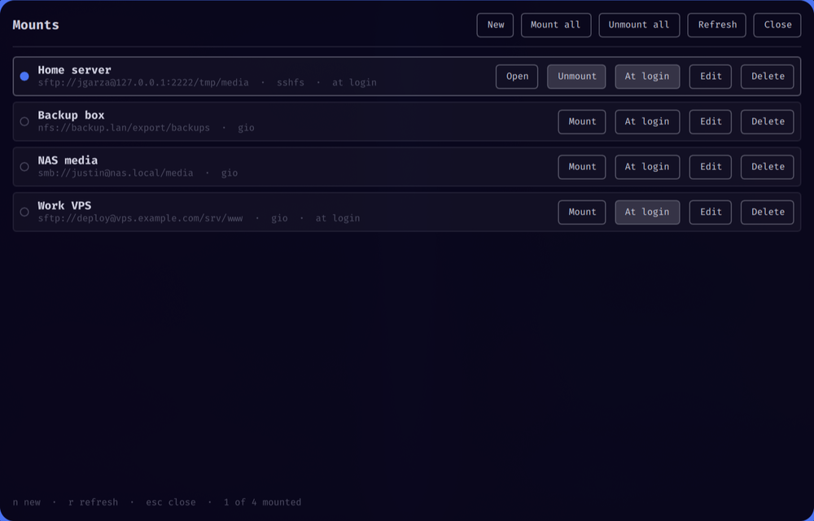

# Mounts



Manage your network mounts (SMB, SFTP/SSH, NFS) from one window on the Omarchy
shell. Save a connection once, then mount and unmount it with a click, open it
in your file manager, or have it mount when you log in. Passwords live in your
keyring, never in a config file.

## What it does

- **Saved connections** for SMB shares, SFTP/SSH hosts and NFS exports, kept in
  `~/.config/omarchy/jgarza.mounts/connections.toml` (no secrets in it).
- **Two ways to mount**, chosen per connection:
  - **gio** (default): GVfs, no root, the share also shows up in Nautilus and other GTK apps.
  - **sshfs** (SFTP only): a FUSE mount under `~/Mounts/<name>`, for tools that need a real path.
- **One click**: Mount / Unmount, Open (in your file manager), plus Mount all and Unmount all.
- **Mount at login**: a per-connection switch that installs a systemd user service
  and sends one notification saying what mounted or failed.
- **Passwords in the keyring** (Secret Service, via `secret-tool`). The form can
  also remove a stored password.
- **Clear errors**: "authentication failed", "can't find that host", "connection
  refused"... instead of raw tool output. A banner warns when a tool you need is missing.
- **Form checks** before saving, so you see what's wrong without trying.
- **Searchable in the Omarchy menu**: type `mount`, `unmount`, `drives`, `network`, `nas`, `smb`...
- **Optional bar icon** with the number of mounted connections.


## Install

From the marketplace, or from git:

```sh
omarchy plugin add https://github.com/jgarza9788/mounts --enable
```

Then check the dependencies and add the menu entry:

```sh
cd ~/.config/omarchy/plugins/jgarza.mounts
./setup.sh --install      # installs what's missing with pacman (asks for sudo), adds the menu entry
```

`./setup.sh` on its own only checks. What it looks for:

| Needed for | Package |
|---|---|
| everything | `glib2` (`gio`), `libsecret` (`secret-tool`), `gvfs` (includes the SFTP backend) |
| SMB shares | `gvfs-smb` |
| NFS exports | `gvfs-nfs` |
| the sshfs backend (optional) | `sshfs`, `fuse3` |

A prebuilt `bin/mountsctl` (x86_64) ships with the plugin. To rebuild it
(needs Rust): `./build.sh`.

## Use

- Search the Omarchy menu for **Mounts** (or `omarchy menu summon mount`).
- Or run `omarchy-shell shell toggle jgarza.mounts`, and bind that to a key if you like.
- Or add the **Mounts** widget to the bar and click it.

Keys in the window: `n` new connection, `r` refresh, `esc` back / close.

### SMB tip
SMB shares need a saved password to mount from this window. Put the share name
in **Share** (for example `media`), and an optional subfolder after it (`media/Movies`).

## Window rule (optional)

The window opens like any other Hyprland window (tiled by default). To float and
size it, add to `~/.config/hypr/hyprland.lua`:

```lua
hl.window_rule({
  name = "mounts-float",
  match = { class = "org.quickshell", title = "^Mounts$" },
  float = true,
  size = "820 620",
  center = true,
})
```

## Menu entry

`./menu.sh install` adds a **Mounts** entry to the Omarchy menu (`./setup.sh --install`
does it too). `./menu.sh remove` takes it out; `./menu.sh status` says whether it's
there. It only edits the block between the `jgarza.mounts` markers in
`~/.config/omarchy/extensions/omarchy-menu.jsonc`, after making a timestamped backup.

## Uninstall / clean up

`./uninstall.sh` walks through six steps, warning and asking before each:
unmount saved connections, remove the mount-at-login service, delete keyring
passwords, delete the config (a backup copy is saved to `~/` first), remove empty
`~/Mounts/<name>` folders, and remove the menu entry. Then it offers to delete build output.

- `./uninstall.sh --dry-run` shows what would happen without changing anything.
- `./uninstall.sh --clean` only deletes build output (`./build.sh` recreates it).
- `./uninstall.sh --yes` skips the questions (warnings still print).

It never removes packages or the plugin folder; it prints the commands for those.

## How it works

The window and bar icon are QML. All real work (config, keyring, `gio` and
`sshfs` commands, systemd unit, status) is in `helper/`, a small Rust program,
`mountsctl`, that prints JSON. You can use it directly:

```sh
bin/mountsctl list            # saved connections and whether each is mounted
bin/mountsctl mount nas       # mount by id
bin/mountsctl unmount nas
bin/mountsctl deps            # which tools are installed
```

Tests: `cd helper && cargo test`.

After editing `Mounts.qml` the shell may keep the old copy; run `omarchy-restart-shell`.

## Notes

- Kernel CIFS (`mount.cifs`, fstab, root) is not used: SMB goes through gio.
- Servers whose login scripts print output (for example a broken `~/.bashrc`)
  can break SFTP; Mounts reports "connected, but the server never answered".

## License

MIT, see `LICENSE`.
